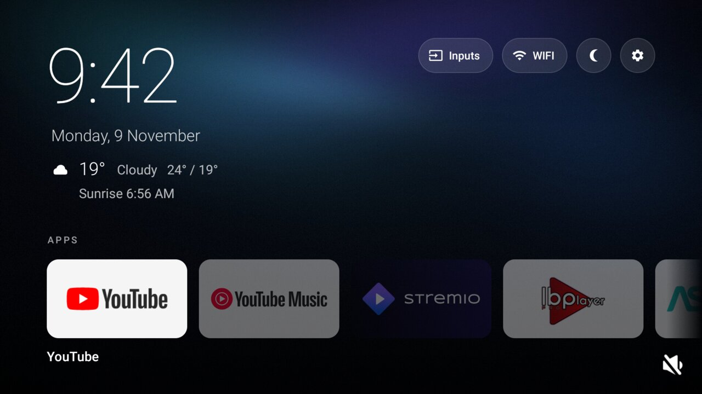
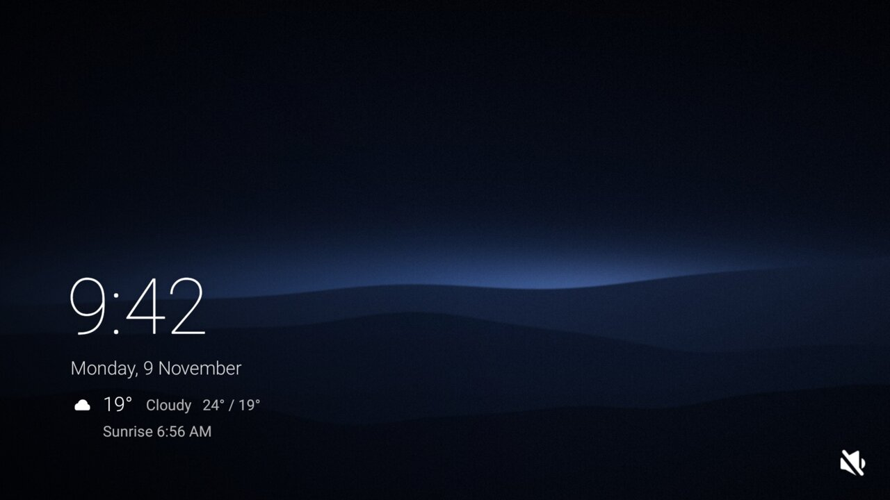

<div align="center">

# tvdetox

Debloat your Google TV over `adb` and give it a calm, minimal home screen and screensaver.

[](LICENSE)
[](https://github.com/0xShady/tvdetox/stargazers)
[](#supported-tvs)
[](#what-gets-changed)
[](#supported-tvs)

 

</div>

## What's inside

- **Debloat**: disable preinstalled apps from lists you edit. Every change is reversible.
- **Home screen**: clock, weather and your apps over a dark wallpaper.
- **Screensaver**: a slow, quiet photo slideshow with the time and weather.

No root, no Gradle, no account. Plain shell scripts and two tiny Java apps.

## Supported TVs

Tested on a Xiaomi Mi TV (MiTV-MOOR2, Google TV, Android 11). The `google-tv` list fits most Google
TVs on Android 10 or newer, and the two apps run on Android 9 or newer. Other brands work once you
add a [list](#debloat-lists) for them.

## Quick start

You need `adb` on your computer and debugging turned on in the TV: see
[Prepare your TV](#prepare-your-tv) if you haven't done that yet.

```bash
git clone https://github.com/0xShady/tvdetox.git && cd tvdetox
cp tv.env.example tv.env              # set TV=<your TV's IP>:5555

./debloat/debloat.sh --dry-run        # see what would change
./debloat/debloat.sh                  # snapshot the TV, then debloat
adb reboot
```

Accept the "Allow USB debugging?" prompt on the TV the first time. Then, optionally:

```bash
./launcher/build-and-install.sh       # home screen
./screensaver/build-and-install.sh    # screensaver
./screensaver/add-photos.sh ~/Pictures/*.jpg    # your photos (--clear removes them)
```

Building the apps needs JDK 17+ and the Android SDK
(`sdkmanager "build-tools;36.1.0" "platforms;android-34"`), found through `ANDROID_HOME`.

## Configuration

Everything lives in `tv.env` (copied from [`tv.env.example`](tv.env.example), never committed).
Rebuild an app after changing a setting it uses.

| Setting | Default | What it does |
| --- | --- | --- |
| `TV` | | TV address, `ip:5555` |
| `DEBLOAT_LISTS` | `google-tv` | Lists from `debloat/lists/` to apply |
| `ANIMATION_SCALE` | `0.5` | `0` off, `1.0` stock |
| `FAVORITES` | YouTube, Netflix, YouTube Music | Apps shown first on the home screen |
| `LATITUDE`, `LONGITUDE` | empty (off) | Turns on weather and sunrise/sunset |
| `TEMP_UNIT` | `celsius` | or `fahrenheit` |
| `WALLPAPER` | `assets/wallpaper.jpg` | Home screen background |
| `SCREENSAVER_WALLPAPER` | `assets/screensaver.jpg` | Screensaver image when you have no photos |

Weather comes from [Open-Meteo](https://open-meteo.com) (free, no key) every 30 minutes. With no
coordinates set, the apps make no network calls at all.

## What gets changed

| Script | Change | Undo |
| --- | --- | --- |
| `debloat/debloat.sh` | Disables the listed apps, removes `uninstall.txt` apps for the current user, blocks background running for `background.txt`, sets animation speed | `debloat/restore.sh` |
| `launcher/build-and-install.sh` | Installs the home screen and its Home button service | `launcher/uninstall.sh` |
| `screensaver/build-and-install.sh` | Installs the screensaver and selects it | `screensaver/uninstall.sh` |
| `screensaver/add-photos.sh` | Copies photos to `/sdcard/Pictures/Screensaver` and restarts the screensaver so it sees them | `add-photos.sh --clear` |

Nothing is removed from the system partition, so a factory reset always brings the TV back to stock.
Before you run it:

- `com.google.android.katniss` is Google Assistant: drop that line to keep voice search.
- `com.google.android.marvin.talkback` is the screen reader: keep it if anyone needs it.

## Debloat lists

One package per line in `debloat/lists/`, text after `#` ignored: `google-tv.txt`,
`xiaomi-mitv.txt`, `uninstall.txt` and `background.txt`. For another TV, check what is installed,
look up anything you don't recognise, and save it as `debloat/lists/<brand>.txt`:

```bash
adb shell pm list packages -s     # system apps
adb shell pm list packages -3     # apps you or the maker installed
```

Pull requests with lists for other TVs are welcome.

## How the home screen works

Google TV only lets system apps be the default home, and disabling the stock launcher can cause a
boot loop. So the stock launcher stays, and a small accessibility service opens this home screen
whenever Home is pressed or the stock one appears. You may see the stock home for a moment at boot.

On the remote, OK opens an app, holding OK opens its App info, and Up reaches the buttons.

## Backups and restore

`debloat.sh` first saves package lists, settings and `getprop` to `backups/<date>/` (add `--apks`
to `debloat/snapshot.sh` to also pull your installed apps). That folder holds your TV's serial and
MAC addresses, so it is gitignored: never share it.

```bash
./debloat/restore.sh                          # re-enable everything
./debloat/restore.sh --apks backups/<date>    # also reinstall pulled APKs
```

## Prepare your TV

1. Install `adb` on your computer: `brew install android-platform-tools` on macOS, or the
   [SDK Platform Tools](https://developer.android.com/tools/releases/platform-tools) for any OS.
2. Turn on developer options on the TV: Settings > System > About, then press OK on
   "Android TV OS build" seven times
   ([Android docs](https://developer.android.com/studio/debug/dev-options#enable)).
3. In Settings > System > Developer options, turn on USB debugging and, if listed, Network
   debugging.
4. Find the TV's IP address in Settings > Network & Internet, put it in `tv.env`, and check the
   connection with `adb connect <ip>:5555`. Accept the prompt on the TV
   ([connecting over Wi-Fi](https://developer.android.com/tools/adb#wireless)).

Menu names vary a little between brands and Android versions.

## Disclaimer

This changes system settings on your TV. It comes as is, without warranty, and you use it at your
own risk. Read the lists before you run them. Not affiliated with Google, Xiaomi or any TV maker.

## License

[MIT](LICENSE). Wallpapers are original and under the same license. Button icons are
[Material Icons](https://github.com/google/material-design-icons) by Google (Apache 2.0).
